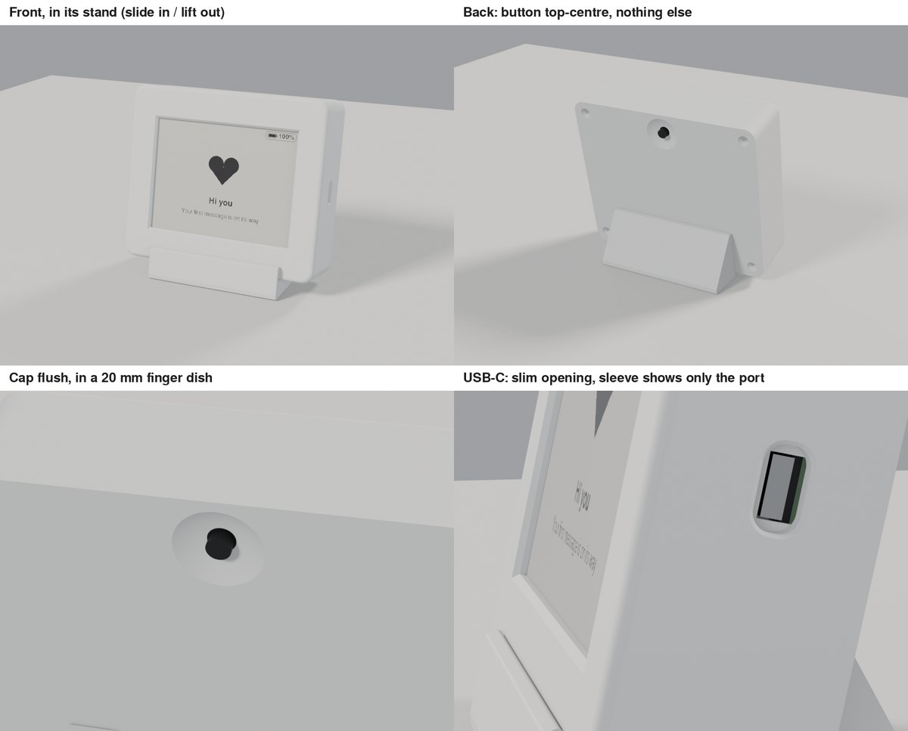
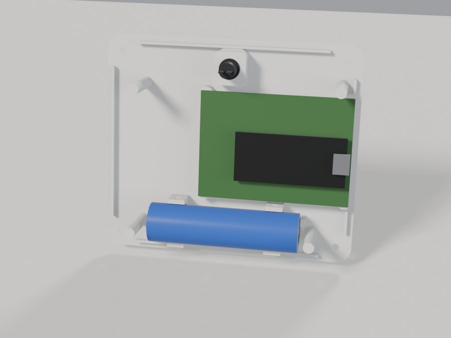

# Heart Frame

A battery-powered 4.2" e-paper message frame. Messages are written in a small
web app on a home server, encrypted, and published to a **private** GitHub
repo. The frame wakes up, fetches anything new, draws it, and goes back to
sleep, for roughly 7 months per charge (an estimate).



```
firmware/    ESP32-S3 (Adafruit Feather) firmware - PlatformIO / Arduino core 3.x
  include/config.h  pins, button polarity, hotspot name, timings (everything you might change)
  lib/hfcore/  formats, crypto, manifest, scheduling (portable C++, host-tested)
  test_host/   host tests (run against vectors produced by the web app)
  tools/       provision.py (USB secrets), ota_keys.py (signed updates)
webapp/      React + TypeScript editor, Node (Fastify + SQLite) server, Docker
enclosure/   parametric OpenSCAD case (v4) + test prints + Blender scene
docs/        BUILD_GUIDE.md - the original build guide (see "Changes since the build guide")
```

Quick commands:

```bash
# firmware
cd firmware && pio run -e feather_s3        # build (feather_s3_4mb for the 4 MB board)
pio run -e feather_s3 -t upload             # flash (hold BOOT, tap RESET first if it won't connect)
make -C test_host MBEDTLS=~/src/mbedtls     # host tests

# web app
cd webapp && npm ci && npm test && npm run build
docker compose up -d --build                # on the home server

# enclosure
cd enclosure && ./export.sh                 # stl/: STLs, 1:1 paper template, insert drawing
./export_blender.sh                         # heartframe.blend: the assembled frame, ready to render
```

## Changes since the build guide

`docs/BUILD_GUIDE.md` describes the first design: a heart-shaped case with
four pink LEDs behind the front, an on/off slide switch and a button on the
top edge. The frame as built is simpler. Where the guide and this section
disagree, this section is right.

### Hardware

- **E-paper only.** The heart LEDs and their MOSFET switch are gone
  (`HAS_HEART_LEDS 0` in `config.h`). The frame just wakes, draws and sleeps.
  The manifest's `led` / `ledMax` / `ledMs` fields are still accepted but
  ignored.
- **Board:** the Feather sits on headers on a 5 × 7 cm double-sided
  perfboard with three resistors: R6 100 kΩ / R7 150 kΩ (USB 5 V sense
  divider into A2) and R8 100 kΩ (button pull-down on A1).
- **Display:** Waveshare 4.2" V2 (SSD1683) on SPI, unchanged from the guide.
- **Battery:** protected 18650 (2200 mAh), unchanged.
- **No on/off switch.** The firmware watchdog (below) covers the one job the
  switch had, restarting a frame that hangs.
- **Button:** a 7 mm panel-mount momentary between 3V3 and A1. The one
  fitted reads HIGH at rest and LOW when pressed, so `config.h` has
  `#define BUTTON_PRESSED_LEVEL LOW`. With a normally-open button wired as in
  the guide, set it to `HIGH`.

### Firmware

- **Wi-Fi setup:** hold the button for about 7 seconds, then let go. The
  frame opens a setup hotspot named by `WIFI_SETUP_NAME` in `config.h`. The
  long press is only checked when the frame wakes, not while the USB console
  is open (type `exit` first). Holding for more than 15 s counts as a stuck
  button and is ignored.
- **Stuck button:** if the button is already down when the frame goes to
  sleep, it wakes on release instead of in a loop, so a frame lying on its
  button doesn't drain the battery.
- **Hotspot password:** kept in flash (NVS), never in the source. Set it with
  `tools/provision.py --portal-pass`, or later with the console command
  `portal-pass <new>` (8 or more characters, no spaces).
- **Watchdog:** if a wake runs longer than 180 s (`AWAKE_LIMIT_S`), the chip
  restarts and goes straight back to sleep: 1 h on battery, 15 min on USB.
  `status` shows `watchdog-restarts=` since power-on.
- **Schedule (defaults):** checks hourly on battery and every 15 min on USB,
  with quiet hours from 23:00 to 07:00. All three can be changed in the web
  app's settings (they travel in the manifest).
- **USB console:** connect at 115200 baud and press Enter within 3 s of
  reset. Useful commands: `status` (battery, button, secrets redacted, state),
  `epd` (test pattern), `sync` (fetch now, verbose), `portal`, `portal-pass`,
  `sleep <s>`, `wifi-forget`, `factory-reset`, `exit`.

## Enclosure (v4)

| | |
|---|---|
|  | **118.9 × 102.8 × 35 mm**, plain front, window centred, borders as slim as the display module allows (16.25 mm at the sides, 18.8 mm top and bottom). Nothing on the top or sides except the USB-C port. |

- **Button** in the back cover, top centre, behind the top border. The cap
  sits flush in a 20 mm finger dish that leaves room for its full 3.5 mm of
  travel. The button's own nut drops into a captive slot.
- **Perfboard** on four posts: M2 screws go through the board's corner holes
  into M2 nuts held in side slots in the posts. No self-tapping into plastic.
- **USB-C:** a slim-plug opening (12.6 × 7 mm) with a sleeve inside that hugs
  the receptacle, so you see the port and not the inside of the frame. Very
  chunky cable plugs won't reach.
- **Display:** clamped by pads on the back cover pressing the module's PCB
  (`presser_xy`). If your module has standoffs, set `epd_standoff_len` and
  `epd_standoff_xy` and the cover presses on those instead.
- **Stand:** a separate part. The frame's bottom edge slides into its groove
  at a 12° lean. Lift the frame out to lay it flat or hang it.
- **Back cover screws:** four corner blocks hanging from the rear face, clear
  of the display module, with M3 threaded inserts.

**Parts** (`./export.sh` writes them to `enclosure/stl/`, which is not
committed):

| File | What | Print |
|---|---|---|
| `front.stl` | front shell | front face down |
| `back.stl` | back cover with button dish, battery cradle, perfboard posts | outside face down, supports under the finger dish only |
| `stand.stl` | slide-in stand | profile flat on the bed, as exported |
| `test_display.stl` | window corner + module pocket | print first: checks the display fit |
| `test_button.stl` | finger dish + button nut slot | checks the button is flush and presses fully |
| `test_usb.stl` | side wall with the USB-C opening and sleeve | wall flat on the bed; checks your cable's plug fits |
| `test_boss.stl` | one corner block | checks the M3 insert or nut |

On a Prusa MK3S in PLA at 0.20 mm, the front takes about 4 h 40 min, the back
about 3 h 10 min and the stand about 2 h 45 min.

**Hardware:**

- 4 × M3 × 8 countersunk screws and 4 × M3 heat-set inserts (a print shop
  fits these, or press them in with a soldering iron). Alternative:
  `-D 'fastener="nut"'` for M3 × 12 screws into M3 nuts.
- 4 × M2 × 8 screws and 4 × M2 hex nuts for the perfboard.
- The push button's own nut.

**Before exporting**, measure your parts with calipers and fill in the
`MEASURED` block at the top of `heartframe.scad`. Lines marked `MEASURE`
matter most: the button's cap-to-shoulder length and nut thickness, the
active-area offsets, and `pb_usb_inset`.

**Clearance:** `fit` (per side) defaults to 0.3 mm, which suits resin (SLA).
For an FDM printer use about 0.4 to 0.45 mm:
`./export.sh -D 'fit=0.45'`. Print `test_display` first either way.

**Blender:** `./export_blender.sh` needs `openscad`, `python3-pillow`, the
FreeSans font (`gnu-free-sans-fonts` on Fedora) and Blender 4.0 or newer. It
exports every part separately (case, display, perfboard, Feather, battery,
button, stand), assembles them in millimetres with materials, puts the
firmware's welcome screen on the display, and sets up a camera and lights.
Open `heartframe.blend` and press F12 to render.

## Deployment (how this instance actually runs)

The build guide (`docs/BUILD_GUIDE.md` §9.5–9.6) assumes the web app is reached
only through **Tailscale Serve**. This deployment does **not** use Tailscale for
the web app. Instead:

```
browser --HTTPS--> Cloudflare --Cloudflare Tunnel--> cloudflared (on the server)
        --> http://localhost:5683 --> heartframe container :8080
```

- **Host:** Debian + CasaOS, Docker Compose project in
  `/DATA/AppData/heartframe/webapp` (`docker compose up -d --build` from there).
- **Port:** host `5683` → container `8080` (see `webapp/docker-compose.yml`).
  The Cloudflare Tunnel's public hostname points at `http://localhost:5683`.
- **HTTPS:** terminated by Cloudflare, so `COOKIE_SECURE` stays `"true"`.
  Set it to `"false"` only if you need to log in over plain
  `http://<server-LAN-IP>:5683`.
- **Not used here:** `tailscale serve`, and `REQUIRE_TAILSCALE_LOGIN` (it relies on
  the header Tailscale Serve adds, so it would refuse every request).
- **Access control:** the app's own password is the only gate. Optionally put
  Cloudflare Access in front of the hostname (email one-time code) for a second
  layer.

### DNS gotcha (why publishing said "fetch failed")

If Tailscale is installed on the server with MagicDNS enabled, the host's
`/etc/resolv.conf` points at Tailscale's resolver. Containers inherit it and,
when it misbehaves, every GitHub call fails with `getaddrinfo EAI_AGAIN` and the
publish log shows `fetch failed (EAI_AGAIN)`. Fixes applied:

1. `dns: [1.1.1.1, 9.9.9.9]` on the service in `webapp/docker-compose.yml`.
2. `sudo tailscale set --accept-dns=false` on the server (the host uses the
   router's DNS again; Tailscale itself keeps working).
3. `sudo systemctl restart docker`, because the Docker daemon keeps the old
   resolver until it restarts (image pulls and builds fail otherwise).

Quick check from the server:

```bash
docker exec heartframe node -e "fetch('https://api.github.com').then(r=>console.log('OK',r.status)).catch(e=>console.log('FAIL',e.cause))"
```

## Web app features added after the guide

- **Light / dark theme:** toggle in the header (and on the login screen).
  Follows the device setting until you pick one; the choice is remembered per
  browser. `src/web/public/theme-init.js` applies it before first paint (a
  separate file because the CSP forbids inline scripts).
- **Heart favicon** and home-screen icon (`src/web/public/`).
- **Clearer publish errors:** the log includes the underlying network cause,
  e.g. `fetch failed (ENOTFOUND)`.

**Round 2 (Oct 2026, merged from `webapp-round-2`):**

- Heart logo and an Outfit wordmark; new messages start blank.
- **Text:** more fonts plus uploaded fonts, bold / italic / underline /
  strikethrough, bullets, text backgrounds (solid box, box per line, white
  outline), invert. Drawing now lands exactly under the pointer.
- **Photos:** Bayer 2 × 2 / 4 × 4 / 8 × 8 and Stucki dithering; drag the photo
  to position it.
- **Draw:** exact 1–64 px square or round brushes, dither pen, uploaded stamps,
  selection with move and resize, redo.
- **Border** tab (was Style): fixed little-hearts and scalloped borders, custom
  saved borders.
- **Library:** sort and favourites. **Settings:** custom uploads, LED options
  removed.
- Existing messages render exactly as before.

---

This repository contains **no secrets and no messages**. Secrets live in
`webapp/secrets/` (git-ignored) and in the frame's flash; messages live only
(encrypted) in the separate private messages repo.
